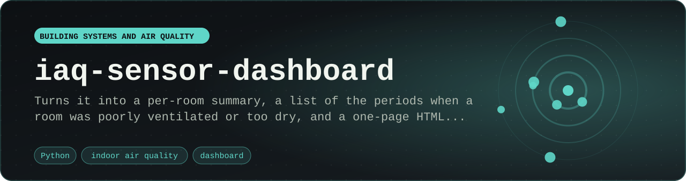
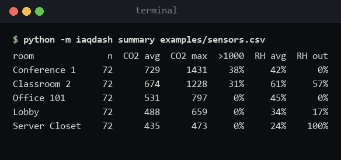

<p align="center"></p>

# iaq-sensor-dashboard

[](https://github.com/yassine2med/iaq-sensor-dashboard/actions/workflows/ci.yml)  

Indoor air quality sensors log CO2 and humidity all day, but a CSV of thousands of readings answers nothing. This tool turns it into a per-room summary, a list of the periods when a room was poorly ventilated or too dry, and a one-page HTML dashboard with a CO2 chart per room.



## What it is for

Facility managers and building engineers use CO2 as a stand-in for ventilation: readings above 1,000 ppm usually mean a room has more people than its air supply can handle. Humidity outside 30 to 60 percent affects comfort, static and mould. Use this tool to find which rooms and which hours need a ventilation or schedule change. It uses the standard library only and the HTML page needs no server. The sample readings are invented: five rooms, hourly, three days.

## Install

```
git clone https://github.com/yassine2med/iaq-sensor-dashboard
cd iaq-sensor-dashboard && pip install -r requirements.txt
```

## How to use

| I want to | Command |
|---|---|
| Per-room numbers, worst room first | `PYTHONPATH=src python -m iaqdash summary examples/sensors.csv` |
| Periods above 1,000 ppm CO2 | `PYTHONPATH=src python -m iaqdash alerts examples/sensors.csv` |
| Periods outside 30 to 60 percent humidity | `PYTHONPATH=src python -m iaqdash alerts examples/sensors.csv --metric rh` |
| Write a one-page dashboard | `PYTHONPATH=src python -m iaqdash html examples/sensors.csv -o dashboard.html` |
| Exit 1 if any row had to be skipped | `PYTHONPATH=src python -m iaqdash summary examples/sensors_with_errors.csv --strict` |
| Show help | `PYTHONPATH=src python -m iaqdash --help` |

Example:

```
PYTHONPATH=src python -m iaqdash summary examples/sensors.csv
```

Output:

```
room              n  CO2 avg  CO2 max  >1000  RH avg  RH out
Conference 1     72      729     1431    38%     42%      0%
Classroom 2      72      674     1228    31%     61%     57%
Office 101       72      531      797     0%     45%      0%
Lobby            72      488      659     0%     34%     17%
Server Closet    72      435      473     0%     24%    100%
```

Run the tests with `python -m pytest -q`.

## How it works

1. The CSV needs timestamp (ISO), room, co2_ppm and humidity_pct. Rows with a bad timestamp, an empty room, a non-number or an implausible value (CO2 outside 250 to 10,000 ppm, humidity outside 0 to 100) are skipped and named on stderr.
2. Per room it computes average and peak CO2, the share of readings above 1,000 ppm and the share of humidity readings outside 30 to 60 percent.
3. `alerts` joins consecutive bad readings of a room into one period with its start, end and peak.
4. `html` writes a self-contained page with one card per room and an SVG line chart of CO2 with a dashed 1,000 ppm line.
5. `examples/make_sample.py` rebuilds the invented sample files.

## Limits

- The 1,000 ppm and 30 to 60 percent limits are common rules of thumb, not a standard for your building; change them in `analysis.py`.
- Periods assume readings arrive one after another; gaps in the data are not detected.
- No live feed: it reads CSV files, not sensors.

## License

MIT. Yassine Emhamed, 2026.
